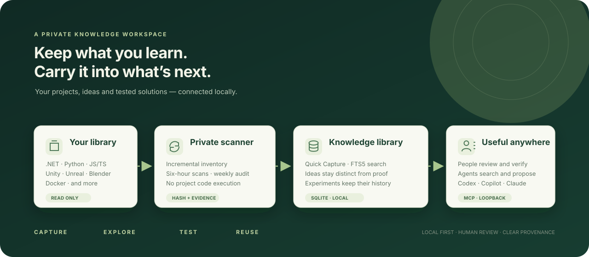
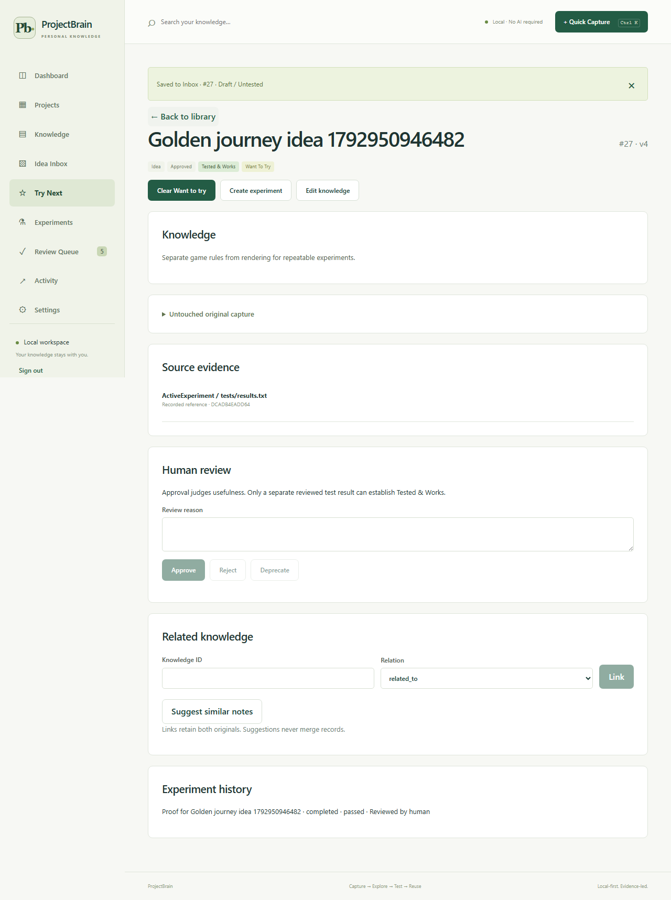

<div align="center">



# ProjectBrain

**Turn your past projects into a better starting point for your next one.**

A local knowledge workspace for project history, quick notes, reusable solutions, and experiments with evidence.

[](https://github.com/Mad-Mange/ProjectBrain/actions/workflows/ci.yml)
[](https://dotnet.microsoft.com/)
[](https://react.dev/)
[](https://www.sqlite.org/fts5.html)

[Get started](#get-started) ? [Connect Codex](#connect-your-coding-agent) ? [Documentation](#documentation) ? [Validation](#validation-and-current-status)

</div>

You solved something useful six months ago. Now the solution is buried in an old game prototype, a Python tool, or a web app. ProjectBrain makes that work searchable and keeps the source references alongside what you learn.

It scans approved project folders without executing their code, saves ideas immediately, and tracks the difference between an interesting suggestion and a solution you have actually tested. Coding agents can search the same library through MCP.

## What you can do

- **Explore previous projects.** Detect .NET/C#, Python, JavaScript/TypeScript, Unity, Unreal, Blender assets, and Docker projects. Inspect profiles, dependencies, cached excerpts, and source paths.
- **Keep the index current.** Incremental scans run every six hours, with a weekly SHA-256 audit. Trigger scans manually, pause scheduling, or cancel work. Missing drives and incomplete scans preserve the previous inventory.
- **Capture an idea in seconds.** Press **Ctrl+K** inside the web app and paste a note or snippet. A title, project, tags, and source URL are optional. The original text is retained.
- **Build your Try Next list.** Flag an idea with **Want to try**, then turn it into an experiment with a hypothesis and measurable success criteria.
- **Keep evidence and history.** Review experiment results, retain conflicting outcomes, and flag proof for rechecking when its source changes.
- **Reuse knowledge through MCP.** Give coding agents bounded search and project context. Agents can propose knowledge and results; people approve them.
- **Back up your workspace.** Download a consistent SQLite backup and restore captures, knowledge, evidence, and review history.

### An idea is not a test result

Each entry has separate fields for **type**, **review status**, **validation status**, and **intent**. Classifying a note as a best practice does not verify it.

The **Tested & Works** badge requires approved knowledge and a human-reviewed passing experiment with current indexed evidence. A source change can make that evidence stale while the original result remains in history.

<details>
<summary><strong>See the experiment review screen</strong></summary>



*Synthetic acceptance-test data. No personal projects, notes, or credentials are shown.*

</details>

## Get started

### Requirements

- Docker with Compose v2 and Linux containers. Docker Desktop is the tested Windows setup.
- An existing folder containing the projects you want to index.
- Internet access for the initial image/package build.

The application runs without an AI provider, model key, or cloud account.

### 1. Clone and configure

```powershell
git clone https://github.com/Mad-Mange/ProjectBrain.git
cd ProjectBrain
Copy-Item .env.example .env
```

Set `PROJECTS_ROOT` in `.env` to your project library, for example `D:/Projects`.

Generate two different access tokens. This PowerShell snippet writes them to the private `.env` without printing them:

```powershell
function New-ProjectBrainToken {
    $bytes = New-Object byte[] 32
    $rng = [Security.Cryptography.RandomNumberGenerator]::Create()
    try {
        $rng.GetBytes($bytes)
        [Convert]::ToBase64String($bytes)
    } finally { $rng.Dispose() }
}

$humanToken = New-ProjectBrainToken
$agentToken = New-ProjectBrainToken
$lines = Get-Content -LiteralPath .env | ForEach-Object {
    if ($_ -match '^PROJECTBRAIN_AUTH_TOKEN=') { "PROJECTBRAIN_AUTH_TOKEN=$humanToken" }
    elseif ($_ -match '^PROJECTBRAIN_AGENT_TOKEN=') { "PROJECTBRAIN_AGENT_TOKEN=$agentToken" }
    else { $_ }
}
[IO.File]::WriteAllLines((Join-Path $PWD '.env'), [string[]]$lines,
    (New-Object Text.UTF8Encoding($false)))
Remove-Variable humanToken,agentToken,lines
```

The human token is for the web interface. The agent token permits retrieval and proposals but cannot approve human decisions. Keep `.env` private and use your existing tokens when updating an installation.

### 2. Start ProjectBrain

```powershell
docker compose config --quiet
docker compose up -d --build --wait
```

Open **[http://127.0.0.1:4318](http://127.0.0.1:4318)** and sign in with `PROJECTBRAIN_AUTH_TOKEN` from your local `.env`.

In **Settings**, register the mounted folder. Leave the relative subfolder blank to use the entire mount, or enter a subfolder. Then choose **Initial Inventory** on the Dashboard.

Your source folder mounts read-only. Application data lives in the separate `projectbrain_data` Docker volume and survives container restarts.

### 3. Save your first idea

Choose **+ Quick Capture** or press **Ctrl+K**. Paste a note, select **I want to try this**, and save it. Open **Try Next** to find the draft and plan an experiment.

Use **Scan Changed** after changing or adding projects. Automatic scanning takes over after the first explicit inventory.

## Connect your coding agent

The Streamable HTTP MCP endpoint is **`http://127.0.0.1:4317/mcp`**. It requires bearer authentication.

### Codex on Windows

With Codex installed and the application running:

```powershell
powershell -NoProfile -ExecutionPolicy Bypass -File scripts/connect-codex.ps1
```

This optional setup script:

1. Checks the dedicated agent credential against the local API.
2. Backs up your existing Codex configuration and instructions.
3. Registers ProjectBrain in your user-level Codex configuration.
4. Stores the agent token in the Windows user environment.
5. Adds English retrieval instructions that new projects inherit.

**Restart Codex once after setup.** New project sessions can then search prior work without adding an MCP configuration to each repository. A [copy-ready English AGENTS snippet](docs/agent-rules/AGENTS.projectbrain.md) is available for a project-local reminder.

An agent can search existing knowledge even when its current project is outside the source mount. Put a project under the mounted library if you also want ProjectBrain to index it.

### Available MCP tools

| Purpose | Tools |
|---|---|
| Search and inspect knowledge | `search_knowledge`, `find_similar_solutions`, `get_knowledge_item` |
| Inspect previous projects | `get_project_profile`, `list_analysis_candidates`, `get_project_analysis_context` |
| Find planned ideas | `list_try_next` |
| Submit for human review | `propose_knowledge`, `propose_experiment_result` |

Reads include provenance and trust statuses, with a 16,000-character response ceiling. Read-only tools are marked accordingly; proposals do not approve or verify knowledge.

The [MCP guide](docs/mcp.md) also includes **GitHub Copilot CLI, VS Code, and Claude Code** configuration. Codex has been tested through a real model session in a new empty project. The other clients have setup templates and checked CLI syntax; their actual agent sessions remain unverified.

## How it works

| Component | Implementation |
|---|---|
| API and MCP server | ASP.NET Core, .NET 10, official C# MCP SDK |
| Background scanner | One worker, staged inventory publication, incremental fingerprints, durable read checkpoints |
| Storage and search | SQLite, FTS5, versioned SQL migrations |
| Web interface | React 19, TypeScript, Vite, unprivileged Nginx |
| Deployment | Two Docker Compose services, loopback host ports, persistent database volume |

The scanner uses deterministic text and metadata extraction. It does not compile projects, restore their dependencies, run Git hooks, or launch Unity, Unreal, or Blender. Binary assets are indexed as metadata.

## Privacy and operational limits

- **Local by default:** scanning, capture, search, experiments, and reviews require no external model. When you connect a coding agent, that agent's own data handling applies to the context it retrieves.
- **Read-only sources:** the source bind mount is read-only; the database and backups are stored separately.
- **Authenticated endpoints:** protected REST/MCP calls require a token. The browser keeps its credential in memory and asks again after a refresh.
- **Loopback deployment:** web `127.0.0.1:4318`, API/MCP `127.0.0.1:4317`. This is a single-user, same-host application; remote and multi-user access are not configured.
- **Conservative input handling:** credential files and common caches are excluded, likely secrets are redacted, and captured URLs are stored without being fetched. Keep credential stores outside source roots.
- **Bounded scans:** file, depth, byte, and time budgets prevent unbounded work. Large Windows bind mounts can take time; progress is visible in the Dashboard.
- **Explicit limitations:** binary scene parsing, semantic embeddings, an OS-wide capture hotkey, and an identity-resolution UI are not implemented. Ambiguous moves are retained for review.

See [operations and recovery](docs/operations.md) for backup/restore and configuration. Avoid `docker compose down -v` when you want to retain the database.

## Development

Requirements: **.NET SDK 10**, **Node.js 24**, and **Python 3.10+** for schema checks. Optional Codex onboarding verification uses Python 3.11+ and your configured Codex model/login.

```powershell
dotnet restore ProjectBrain.slnx --configfile NuGet.Config
dotnet build ProjectBrain.slnx --no-restore
dotnet test ProjectBrain.slnx --no-build

npm.cmd --prefix frontend ci
npm.cmd --prefix frontend run build
npm.cmd --prefix frontend test

python tests/schema_test.py
```

On Linux/macOS, use `npm` in place of `npm.cmd`.

### Browser and container checks

```powershell
npm.cmd --prefix frontend exec -- playwright install chromium
npm.cmd --prefix frontend run e2e
powershell -NoProfile -ExecutionPolicy Bypass -File scripts/compose-smoke.ps1 -Browser
```

These checks use copied synthetic fixtures and loopback ports **14317/14318**, so your regular instance can stay running. The Compose test checks health, non-root execution, a read-only source mount, MCP, and capture/experiment persistence after restart. It stops its test containers and retains their test volume.

For an optional real Codex session using user-global configuration:

```powershell
python scripts/codex-onboarding-smoke.py
```

This check calls the model already configured in Codex. It is not required to run the application or the deterministic test suite.

## Validation and current status

Validated on Windows and Docker Desktop on **2026-10-25**:

| Check | Result |
|---|---|
| .NET domain, service, SQLite, HTTP, MCP, and reliability tests | 108 passed |
| Standalone SQLite/FTS5 schema tests | 8 passed |
| React tests | 3 passed |
| Playwright journeys against the local API and Docker deployment | 2 journeys passed |
| Docker health, source protection, and restart persistence | Passed |
| Codex retrieval from a new empty project using global configuration | Passed |

The Codex session searched real indexed records, inspected a project profile, and kept draft/untested statuses explicit. The empty test project required no local `AGENTS.md` or MCP configuration.

The [implementation progress log](IMPLEMENTATION_PROGRESS.md) records task IDs, acceptance results, commands, and remaining validation gaps. The original design specifications and starter templates are retained under `ProjectBrain_v2_Agent_Package/`; the implemented application lives under `src/` and `frontend/`.

## Project structure

```text
src/
  ProjectBrain.Api/             REST, authentication, MCP, scanner host
  ProjectBrain.Application/     Shared application contracts
  ProjectBrain.Domain/          Lifecycle rules and source-path safety
  ProjectBrain.Infrastructure/  SQLite, migrations, scanner, extraction
frontend/                        React application and browser tests
tests/                           Domain, integration, schema, and fixture tests
scripts/                         Quality checks, Compose smoke, Codex setup
docs/                            API, operations, security, and agent guidance
```

## Documentation

- [Operations, backup, and restore](docs/operations.md)
- [REST API and database schema](docs/api.md)
- [MCP setup and agent onboarding](docs/mcp.md)
- [English AGENTS text](docs/agent-rules/AGENTS.projectbrain.md)
- [Threat model](docs/threat-model.md)
- [Architecture decisions](docs/decisions/001-v2-implementation.md)
- [Implementation and acceptance results](IMPLEMENTATION_PROGRESS.md)
